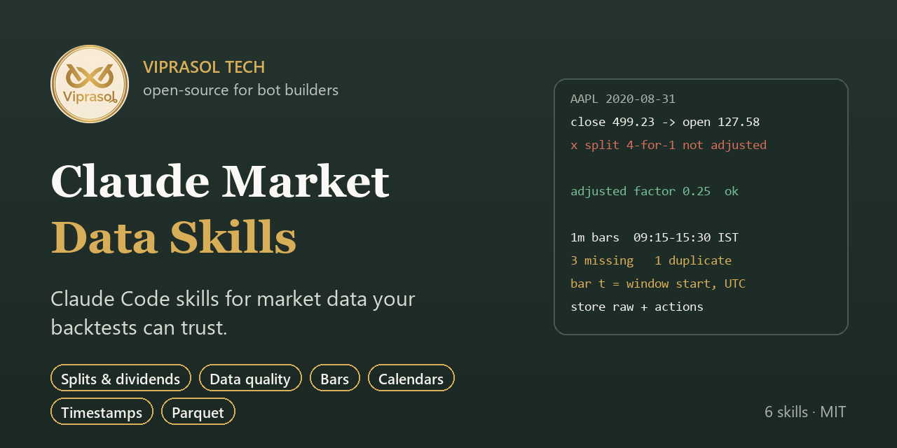

<div align="center">



### Claude Code skills for market data you can trust

**Split and dividend adjustment · data quality checks · bar building · exchange calendars · timestamps and time zones · Parquet / DuckDB storage**<br>
Bad data never crashes a backtest. It makes it look good. These skills catch it first.

[](https://github.com/Viprasol-Tech/claude-market-data-skills/stargazers)
[](LICENSE)
[](https://code.claude.com/docs/en/skills)
[](#-whats-inside)
[](https://github.com/Viprasol-Tech/claude-market-data-skills/actions/workflows/ci.yml)

[Quick start](#-quick-start) · [What's inside](#-whats-inside) · [Examples](#-just-ask) · [Scripts](#-bundled-scripts) · [Changelog](CHANGELOG.md)

</div>

---

## 💬 Just ask

Install once, then talk to Claude Code normally. The right skill loads by itself.

```text
> My backtest shows a -50% day for AAPL in 2020. Is the data adjusted?
> yfinance, Alpaca and Polygon give me different closes. Which is right?
> Check this 1-minute NIFTY file for gaps, duplicates and bad ticks.
> Build 5-minute bars from these trades so they match TradingView.
> Why are my US bars an hour off every March?
> Design storage for 5 years of 1-minute bars for 2,000 symbols.
```

## 📦 What's inside

| Skill | What it does |
| --- | --- |
| 🧾 **`corporate-actions`** | Split, bonus, reverse-split and dividend **back-adjustment** (CRSP/Yahoo method), what Yahoo, yfinance, Massive/Polygon, Alpaca, Databento, Tiingo and EODHD return by default, NSE F&O adjustment factors, and which series to use for signals vs. orders. Ships an **adjuster** and a split scanner. |
| 🔍 **`data-quality`** | OHLC consistency, duplicates, gaps against sessions and holidays, frozen bars, robust outliers, survivorship bias, renamed tickers, vendor reconciliation. Ships a **bar checker**. |
| 🕯️ **`bar-building`** | Start-labelled, left-closed bars; session alignment (NSE 09:15); empty intervals; volume and dollar bars; how each vendor and pandas label bars. Ships a **trades-to-bars builder**. |
| 📅 **`market-calendars`** | `exchange_calendars` vs. `pandas_market_calendars` (who supports NSE), NYSE half-days, NSE holiday circulars and Muhurat trading, schedulers and annualising. |
| 🕒 **`timestamps`** | UTC storage, DST gaps (US vs. EU dates), naive vs. aware, ms vs. ns, Parquet `isAdjustedToUTC`, Arrow and Spark pitfalls, MT5 server time. |
| 🗄️ **`data-storage`** | Raw → clean → derived layers, Parquet + DuckDB with Hive partitions, QuestDB and TimescaleDB for ticks, metadata, point-in-time versions, NSE UDiFF bhavcopy. |

Facts come from the vendors', exchanges' and libraries' own documentation
(checked November 2026) and are linked from each skill's `reference.md`,
together with what could not be confirmed.

## ⚡ Quick start

**Option A: Claude Code plugin (recommended)**

```bash
claude plugin marketplace add Viprasol-Tech/claude-market-data-skills
claude plugin install market-data@claude-market-data-skills
```

Skills are then available as `/market-data:<skill>` and load automatically
when your request matches.

Want every Viprasol plugin? Add the [Viprasol marketplace](https://github.com/Viprasol-Tech/claude-plugins) once:
`claude plugin marketplace add Viprasol-Tech/claude-plugins`, then
`claude plugin install <plugin>@viprasol`.

**Option B: installer** (copies the skills to `~/.claude/skills`)

```bash
git clone https://github.com/Viprasol-Tech/claude-market-data-skills
cd claude-market-data-skills
bash install.sh                                        # macOS / Linux
powershell -ExecutionPolicy Bypass -File install.ps1   # Windows
```

No API keys, no accounts, no network calls. The scripts need only Python 3.10+.

## 🧰 Bundled scripts

**`adjust_prices.py`** - find unadjusted splits, then adjust:

```text
$ python adjust_prices.py raw.csv --scan
2026-01-07: previous close 204 -> open 102 (x0.5000), looks like a 2-for-1 split; check corporate actions
$ python adjust_prices.py raw.csv --actions actions.csv
date,open,high,low,close,volume,factor
2026-01-05,100,102,99,101,2000,0.5
2026-01-06,101,103,100,102,2200,0.5
2026-01-07,102,104,101,103,2400,1
```

**`bar_check.py`** - a quality report before anything trusts the data:

```text
$ python bar_check.py nifty_1m.csv --interval 1m --session 09:15-15:30 --tz +05:30
ERROR   line 40: duplicate timestamp 2026-11-23T09:55:00+05:30
WARNING 3 expected bar(s) missing, e.g. 2026-11-23T09:35:00+05:30, 2026-11-23T09:36:00+05:30, 2026-11-23T09:37:00+05:30 (check holidays/session)
58 bars, 1 errors, 1 warnings
```

**`make_bars.py`** - time, volume and dollar bars with explicit labelling rules.

## 🗂️ Repository layout

```text
.claude-plugin/marketplace.json          marketplace manifest
plugins/market-data/
  .claude-plugin/plugin.json             plugin manifest
  skills/<skill>/SKILL.md                one folder per skill
  skills/<skill>/reference.md            sources and open questions
  skills/corporate-actions/scripts/adjust_prices.py
  skills/data-quality/scripts/bar_check.py
  skills/bar-building/scripts/make_bars.py
tests/validate_repo.py                   CI: manifests, frontmatter, links, scripts
```

## ⚠️ Disclaimer

Engineering guidance only, **not financial advice**. Check each data
vendor's licence before storing or redistributing data; free sources such as
yfinance are for personal use. Viprasol Tech is not affiliated with Yahoo,
Massive, Alpaca, Databento, Tiingo, EODHD, NSE, NYSE, Anthropic or any other
company mentioned here.

## 🤝 Contributing

Corrections with a link to the official documentation are the most valuable
contribution. See [CONTRIBUTING.md](CONTRIBUTING.md) and run
`python tests/validate_repo.py` before opening a PR. More free Claude Code
packs from Viprasol:
[claude-ml-trading-skills](https://github.com/Viprasol-Tech/claude-ml-trading-skills) ·
[claude-ai-trading-agent-skills](https://github.com/Viprasol-Tech/claude-ai-trading-agent-skills) ·
[claude-trading-skills](https://github.com/Viprasol-Tech/claude-trading-skills) ·
[claude-options-trading-skills](https://github.com/Viprasol-Tech/claude-options-trading-skills) ·
[claude-prop-firm-skills](https://github.com/Viprasol-Tech/claude-prop-firm-skills) ·
[claude-tradingview-automation-skills](https://github.com/Viprasol-Tech/claude-tradingview-automation-skills) ·
[claude-crypto-bot-skills](https://github.com/Viprasol-Tech/claude-crypto-bot-skills) ·
[claude-fintech-skills](https://github.com/Viprasol-Tech/claude-fintech-skills) ·
[claude-india-stack-skills](https://github.com/Viprasol-Tech/claude-india-stack-skills) ·
[claude-voice-agent-skills](https://github.com/Viprasol-Tech/claude-voice-agent-skills) ·
[claude-video-editing-skills](https://github.com/Viprasol-Tech/claude-video-editing-skills).

## 📬 Contact — Viprasol Tech Private Limited

Need a market data pipeline, tick store or research platform for a trading
team? That is what we build.

- 🌐 Website: [viprasol.com](https://viprasol.com)
- ✉️ Email: [support@viprasol.com](mailto:support@viprasol.com)
- 💬 Telegram: [t.me/viprasol_help](https://t.me/viprasol_help) · 📱 WhatsApp: +91 96336 52112
- 🐙 GitHub: [@Viprasol-Tech](https://github.com/Viprasol-Tech) · 💼 [LinkedIn](https://www.linkedin.com/in/viprasol/) · 𝕏 [@viprasol](https://twitter.com/viprasol)

## License

[MIT](LICENSE) © 2026 Viprasol Tech Private Limited
